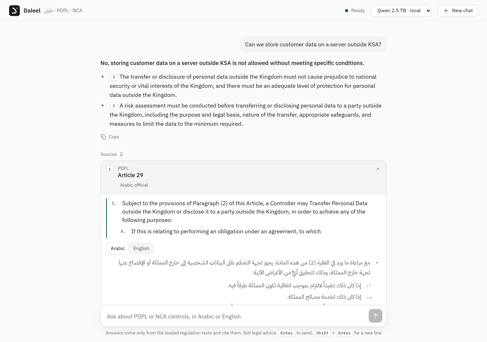
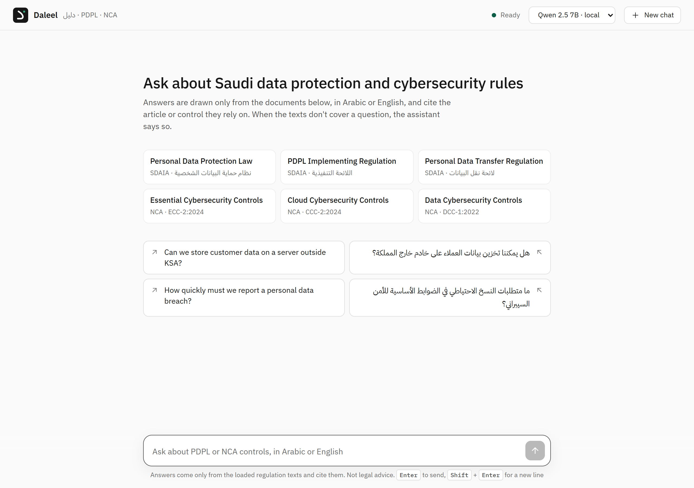
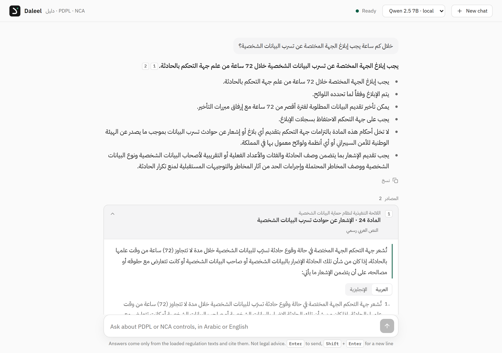

<p align="center">
  
</p>

<h1 align="center">Daleel <bdi>دليل</bdi></h1>

<p align="center">
  Answers to Saudi data-protection and cybersecurity questions, in Arabic or English,<br>
  drawn only from the regulations and cited to the article or control.
</p>

<p align="center">
  <a href="https://github.com/YSFWRLD/daleel/actions/workflows/ci.yml"></a>
  <a href="LICENSE"></a>
  
  
</p>

*Daleel* (دليل) means both "guide" and "evidence" in Arabic: every answer has to point to its evidence in
the text.

<p align="center">
  
</p>

It answers only from the regulation texts, cites the exact article or control, shows the binding Arabic
text next to the English translation, and says "I don't know" when the sources do not support an answer.
Everything runs locally and for free: Postgres + pgvector in Docker, and Ollama on the host GPU.

> [!NOTE]
> Not legal advice. Answers are drafted by a language model from retrieved text; check the cited source
> before relying on them.

## Documents covered

| Document | Issuer | Unit |
|---|---|---|
| Personal Data Protection Law (PDPL) | SDAIA | 43 articles |
| PDPL Implementing Regulation | SDAIA | 38 articles |
| Regulation on Personal Data Transfer outside the Kingdom (v2.0) | SDAIA | 9 articles |
| Essential Cybersecurity Controls (ECC-2:2024) | NCA | controls |
| Cloud Cybersecurity Controls (CCC-2:2024) | NCA | controls |
| Data Cybersecurity Controls (DCC-1:2022) | NCA | controls |

Each document is ingested in both languages. The Arabic text is treated as authoritative
([decision 001](docs/decisions/001-arabic-is-binding.md)); NCA's PDFs state this explicitly, and one real
content difference was found (ECC 2-7-3 exists only in Arabic).

## How it works

```
Browser chat page ─► FastAPI ─► retrieval ─────────────────────────────► answer
                                 │ BM25 (Arabic-normalized)              │ Qwen 2.5 7B (Ollama, GPU)
                                 │ pgvector, one search per language     │ JSON schema output
                                 │ Reciprocal Rank Fusion                │ citation + quote checks
                                 │ optional cross-encoder reranker (CPU) │ abstain if unsupported
```

1. **Extraction** ([ingest/](ingest/)): PyMuPDF with repairs for reversed Arabic glyph order, mirrored
   brackets and split list markers; OCR for scanned pages and graphics-only control tables.
2. **Chunking**: one chunk per article or control (long articles split, keeping the article number), with
   a fixed-size baseline for comparison. Arabic and English versions share a canonical key so every
   citation can show both.
3. **Retrieval** ([app/retrieval/hybrid.py](app/retrieval/hybrid.py)): BM25 and bge-m3 vector search,
   fused with RRF. Vector search runs once per language, and each list's top results are kept, so an
   English question can still reach text that exists only in Arabic.
4. **Answer** ([app/answer.py](app/answer.py)): the model returns `{answer, points, citations, answerable}`
   under a JSON schema that only allows the ids of the retrieved sources. Quotes are checked against the
   source text. With no valid citation, or when the model marks the question unanswerable, the assistant
   says it does not know.

## Results

69 questions (36 English, 33 Arabic): direct questions, version-difference questions, compliance
scenarios ("we do X, is that allowed?"), and 9 out-of-scope questions. Full tables, ablations and error
analysis: [eval/results.md](eval/results.md).

Default configuration (article chunks, hybrid search, no reranker, Qwen 2.5 7B Q4 on an RTX 2070 Super):

| Metric | Value |
|---|---|
| Retrieval: gold source in top 5 / MRR | 95% / 0.82 |
| Answered, of answerable questions | 100% |
| Said "I don't know", of out-of-scope questions | 78% (7 of 9) |
| Answers citing a gold source | 93% |
| Citations that are gold sources | 75% |
| Quotes found verbatim in the source | 100% |
| Faithfulness (claims supported by the cited text, LLM-judged) | 90% |
| Latency p50 / p95 (end to end, warm) | 5.2 s / 9.3 s |

What the ablations showed:

- Article-aware chunking beats fixed-size chunks (answers citing a gold source: 93% vs 87%, both with
  the reranker).
- The cross-encoder reranker improves rank 1 (82% vs 73%) but not the answers, since the model reads all
  five sources; it is off by default and saves about 3 s per question.
- Qwen 2.5 1.5B is not usable here: it declined only 3 of 9 out-of-scope questions.
- Deciding answerability after drafting the answer (prompt v2) fixed scenario questions, which prompt v1
  mostly refused. Prompt v3 stopped "does not comply" verdicts on questions that only ask what a rule
  says (citations that are gold sources: 71% to 75%).

Caveats: the gold set is a draft awaiting expert review ([eval/questions_review.md](eval/questions_review.md));
prompt and retrieval changes were made while looking at these questions, so the numbers are optimistic;
69 questions is a small set; faithfulness is judged by a model of the same family. Known failures: two
out-of-scope questions (SAMA's framework, unpaid overtime) get answered from unrelated controls, and
three scenarios phrased far from the regulation's wording miss their source in retrieval.

## Screenshots

<table>
  <tr>
    <td width="50%"></td>
    <td width="50%"></td>
  </tr>
  <tr>
    <td>Start page: the six documents and example questions.</td>
    <td>Arabic question, answered right to left from Implementing Regulation Article 24.</td>
  </tr>
</table>

## Run it

Requirements: Docker Desktop, [Ollama](https://ollama.com/download), Python 3.11+ (for loading data and
running the evaluation). A GPU with 8 GB of VRAM runs the 7B model; without one, use `qwen2.5:1.5b`
(lower quality) or the Gemini free tier.

```powershell
git clone https://github.com/YSFWRLD/daleel.git
cd daleel
ollama pull qwen2.5:7b-instruct-q4_K_M
ollama pull bge-m3
copy .env.example .env
docker compose up -d db
python -m venv .venv
.venv\Scripts\pip install -e ".[dev]"
.venv\Scripts\python -m ingest.load      # embeds the committed chunks (data/processed) into pgvector
docker compose up -d --build api
```

On an 8 GB GPU, keep one chat model loaded at a time (`ollama ps`, `ollama stop <model>`): two chat
models plus bge-m3 do not fit, and Ollama then runs part of the model on the CPU, many times slower.

Open http://localhost:8000. `GET /health` reports the database and model status; `POST /ask` takes
`{"question": "..."}`.

The processed chunks are committed, so the PDFs are only needed to rebuild them: put the files listed in
[data/sources.yaml](data/sources.yaml) under `data/raw/` and run `python -m ingest.build` (needs the
`ingest` extra).

### Configuration

Set in `.env` (see [.env.example](.env.example)):

| Variable | Default | |
|---|---|---|
| `LLM_PROVIDER` | `ollama` | or `gemini` (free key from Google AI Studio) |
| `OLLAMA_MODEL` | `qwen2.5:7b-instruct-q4_K_M` | any Ollama chat model |
| `CHUNKING` | `article` | or `fixed` |
| `RERANKER` | `none` | `bge` turns on the CPU cross-encoder; build the image with `--build-arg RERANKER=bge` |
| `TOP_K` | `5` | sources passed to the model |

## Evaluation

```powershell
.venv\Scripts\python -m eval.run_eval --name my-run                  # retrieval only, ~30 s
.venv\Scripts\python -m eval.run_eval --name my-answers --answers --judge
.venv\Scripts\python -m eval.report                                  # rebuilds eval/results.md
bash eval/run_all.sh                                                 # every experiment (~2 h)
```

Metrics: Hit@k and MRR over articles/controls (a question may list several acceptable sources), citation
precision and recall, abstention accuracy, LLM-judged faithfulness, and p50/p95 latency, split by
language and by question type.

## Tests and CI

```powershell
.venv\Scripts\pytest                         # unit tests, no services needed
.venv\Scripts\pytest -m integration          # needs Postgres with loaded chunks and Ollama
```

[GitHub Actions](.github/workflows/ci.yml) runs three jobs:

- lint (ruff) and unit tests;
- integration: a pgvector service container and Ollama on the runner's CPU (`bge-m3`, `qwen2.5:1.5b`),
  loads the chunks, runs the integration tests, fails if retrieval Hit@5 drops below 0.90, and runs a
  4-question answer smoke test; the run files are uploaded as an artifact;
- Docker: builds the image, starts it with the database and checks `/health` and the chat page.

Answer-quality tests marked `llm` need the 7B model and run only locally.

## Project layout

```
app/        API, answer generation, retrieval, LLM clients, Arabic text handling, chat page
ingest/     PDF extraction, OCR, chunking, loading into pgvector
eval/       questions, metrics, runner, report, saved runs
data/       sources.yaml, processed chunks (raw PDFs are git-ignored)
db/         schema
docs/       design decisions and roadmap
tests/      unit and integration tests
```

## Roadmap

See [docs/roadmap.md](docs/roadmap.md): chat history and follow-up questions are planned for a later phase.

## License

Code: [MIT](LICENSE). The regulation texts in `data/processed/` are extracted from documents published by
SDAIA and the National Cybersecurity Authority (NCA) and remain theirs; they are included so the
evaluation can be reproduced. This project is not affiliated with or endorsed by SDAIA or NCA.
